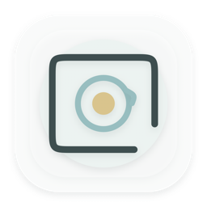

  

<h1 align="center">Seen</h1>

让瞬间被看见。

  <a href="https://github.com/Damaris-bot/seen-macos/releases/latest">
    <strong>下载 Seen for macOS →</strong>
  </a>

Seen 是一个完全在本地运行的 Mac 小工具，可以把视频中的一段裁剪成会动的实况照片。

可以选择裁剪区间、旋转方向、封面画面、原声开关和发布画幅，并导出为 Apple 实况照片或华为/安卓动态照片。

## 功能

- 导入 MOV、MP4 等本地视频
- 选择最长 3 秒的动态片段
- 向左、向右旋转 90°
- 在时间轴上选择封面，或导入已经修好的图片
- 关闭原声，导出文件同步移除音轨
- Apple 实况：保存到照片，或导出 JPG + MOV
- 安卓/华为实况：导出单文件动态 JPG
- 朋友圈、小红书、抖音、Instagram 帖文和快拍画幅
- 全程本地处理，不上传素材

## 下载与安装

前往 [最新版本](https://github.com/Damaris-bot/seen-macos/releases/latest)，下载 `Seen-macOS.zip`。

1. 解压 ZIP。
2. 把 `Seen.app` 拖入“应用程序”。
3. 首次启动时，如果 macOS 提示无法验证开发者，请前往“系统设置 → 隐私与安全性”，找到 Seen 并点击“仍要打开”。
4. 第一次保存到照片时，允许 Seen 添加照片。

## 系统要求

- Apple 芯片 Mac
- macOS 14 或更高版本

当前版本尚未提供 Intel、Windows 或 Universal 版本。

## Apple 实况与安卓实况

Apple 实况以 JPG/HEIC + MOV 配对保存，适合同步到 iPhone、iPad 或导入系统“照片”App。

安卓实况导出为单张内嵌 H.264 视频的 JPG，目前主要验证了华为设备。不同安卓厂商的相册支持范围可能不同。

## 隐私

Seen 不包含账号、统计或云端服务。视频读取、裁剪、封面截取和元数据写入都在本机完成。

如果用户自己开启了“照片”App 的 iCloud 照片同步，保存后的项目可能由系统按既有设置参与同步；这不是 Seen 发起的上传。

## 当前限制

- 应用尚未完成 Apple Developer ID 公证
- 只提供 Apple 芯片构建
- 没有自动更新
- Windows 版尚未实现

## 版本记录

- 1.9.2：文案、正式 Bundle ID、汝窑天青视觉
- 1.9.1：原声开关与静音导出
- 1.9.0：汝窑天青视觉与艺术字
- 1.8.0：现代纯净瓷器视觉
- 1.7.0：Seen 品牌重构
- 1.6.0：安卓动态照片和平台画幅

---

Seen 的源代码为私有项目，此仓库仅用于作品展示与应用下载。
